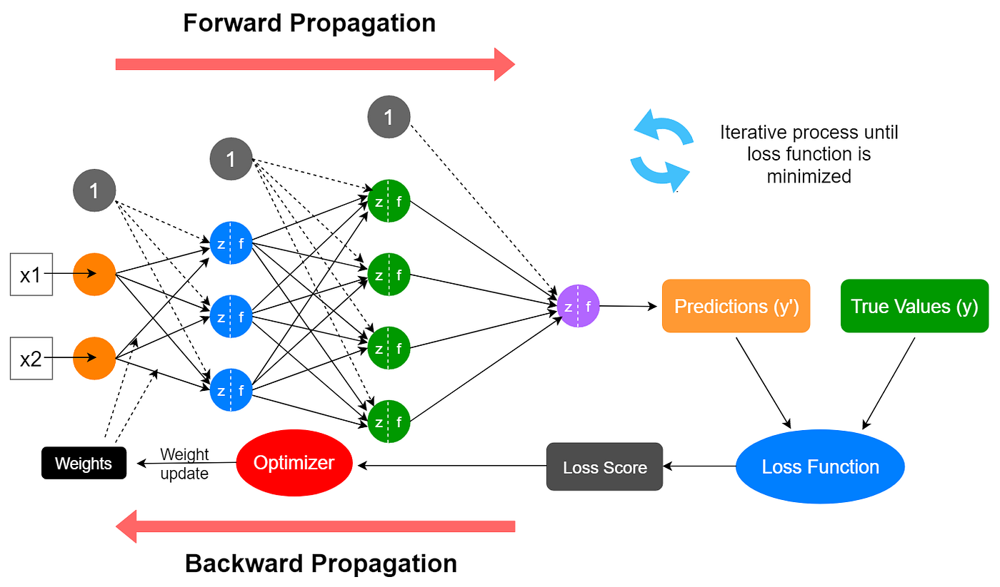
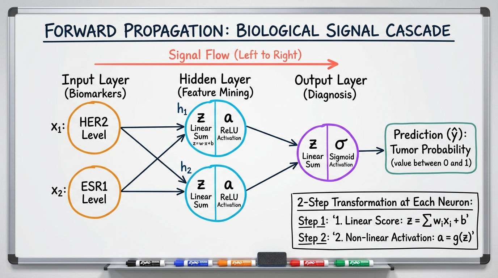
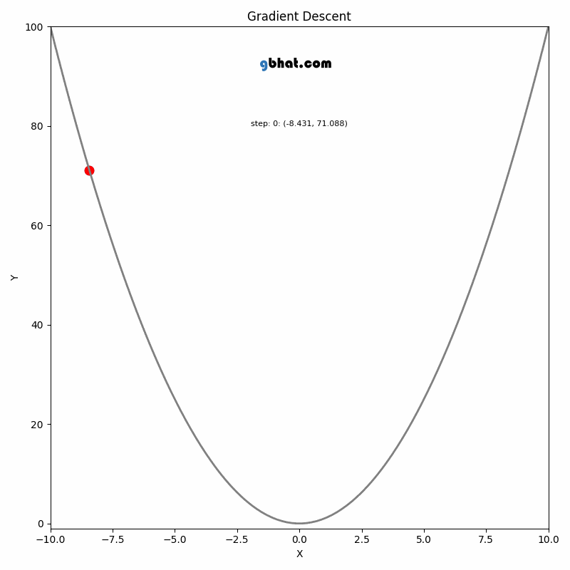
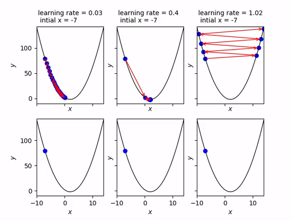
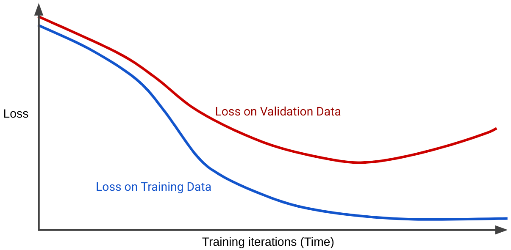

# 3.1 How Neural Networks Learn: Forward Propagation, Loss, and Backpropagation



In [3.1 Basics of Artificial Neural Networks](3.1_neural_networks_primer.md), we explored the anatomy of an artificial neuron and saw how stacking neurons into layers produces a network architecture. In our Groundnut Fair intuition hook, the decision weights ($w_1 = 5, w_2 = 2, w_3 = -3$) and bias ($b = 1$) were already known.

In real-world computational biology, **no one hands us the weights**. 

When we receive an RNA-seq matrix of 20,000 genes across 400 tumor biopsies, or a digital pathology slide containing thousands of morphometric measurements, we start with completely random numbers for our weights. If we feed a patient biopsy into a randomly initialized network, its prediction is essentially a random guess.

### The Automated Instrument Thought Experiment

Consider how an automated robotic fluorescence microscope is calibrated in a wet lab. When first assembled, the instrument has 50 uncalibrated optical dials. If you turn it on, the biopsy image on the screen is a blurry gray smear. 

How would you calibrate those 50 dials if you cannot compute the complete optical physics of every lens from scratch?

1. You measure how blurry the current image is compared to a sharp reference slide (**Error Measurement**).
2. You test how turning a specific dial slightly clockwise changes that blurriness (**Sensitivity Assessment**).
3. You nudge that dial in the direction that makes the image sharper (**Corrective Adjustment**).

You repeat this process across all dials until the image comes into crisp focus.

This is precisely how an Artificial Neural Network learns. It operates through an autonomous **Internal Calibration Loop** consisting of three interconnected stages:

1. **Forward Propagation:** The network takes the patient's biological features, carries them forward layer by layer through a molecular-like cascade, and outputs a diagnostic prediction ($\hat{y}$).
2. **Loss Function:** An objective referee compares the prediction to the patient's ground-truth pathology label ($y$) and calculates a penalty reflecting the clinical severity of the mistake.
3. **Backpropagation & Optimization:** Like an endocrine negative feedback loop, the error signal travels backward through the layers. The network calculates which specific weights caused the error and nudges each weight downhill toward minimal error.

---

## 1. Forward Propagation: The Biological Signal Cascade

Forward propagation is the process of transmitting raw biological input measurements through the network, from the Input Layer, through intermediate Hidden Layers, to produce a final diagnosis in the Output Layer.

Biologically, think of forward propagation as a **cellular signal transduction cascade** (such as the EGFR / MAPK kinase pathway):
* Extracellular ligands (input biomarkers) bind to surface receptors.
* Receptors activate secondary messenger kinases inside the cell (hidden layer neurons).
* Each kinase integrates incoming phosphorylation signals, reaches an activation threshold, and phosphorylates downstream targets.
* The signal culminates in the cell nucleus, triggering a transcriptional decision (output: proliferation vs. apoptosis).



### The Two-Step Transformation at Every Neuron

Within every hidden and output neuron, two distinct mathematical operations occur in strict sequence:

1. **The Linear Combination ($z$):** The neuron calculates the weighted sum of all incoming signals and adds its baseline resting state (bias):
   $$z = \mathbf{w}^T \mathbf{x} + b = \sum_{j=1}^{p} w_j x_j + b$$

2. **The Non-Linear Activation ($a$):** The linear score $z$ is passed through an activation function $g(z)$ to produce the neuron's firing strength (activation $a$):
   $$a = g(z)$$

Why is the non-linear activation essential? Without it, chaining twenty layers of neurons would collapse mathematically into a single linear equation, making a deep neural network no more powerful than basic Linear Regression. Non-linear activations (like **ReLU** and **Sigmoid**) allow the network to bend and carve complex, non-linear decision boundaries through biological feature space.

---

### Tracking the Numbers: A Concrete Two-Biomarker Walkthrough

To understand the mechanics without abstraction, let us trace a single breast cancer patient sample through a minimal network with **2 input biomarkers**, **1 hidden layer with 2 neurons**, and **1 output neuron**:

* **Input Biomarker 1 ($x_1 = 1.5$):** *HER2* expression ($+1.5$ standard deviations above healthy baseline; oncogenic overexpression).
* **Input Biomarker 2 ($x_2 = 0.8$):** *ESR1* (Estrogen Receptor 1) expression ($+0.8$ standard deviations above healthy baseline).

$$\mathbf{x} = \begin{bmatrix} 1.5 \\ 0.8 \end{bmatrix}$$

#### Step 1: Input Layer to Hidden Layer

Let the weights connecting our 2 inputs to hidden neuron 1 ($h_1$) and hidden neuron 2 ($h_2$) be:

$$\mathbf{W}^{[1]} = \begin{bmatrix} 0.4 & -0.6 \\ 0.8 & 0.2 \end{bmatrix}, \quad \mathbf{b}^{[1]} = \begin{bmatrix} 0.1 \\ -0.3 \end{bmatrix}$$

Notice how the weight matrix is organized:
* **Row 1 $[0.4, -0.6]$:** How hidden neuron $h_1$ listens to (*HER2*, *ESR1*).
* **Row 2 $[0.8, 0.2]$:** How hidden neuron $h_2$ listens to (*HER2*, *ESR1*).

First, calculate the linear scores $\mathbf{z}^{[1]}$:
$$z_1^{[1]} = (0.4 \times 1.5) + (-0.6 \times 0.8) + 0.1 = 0.60 - 0.48 + 0.10 = 0.22$$
$$z_2^{[1]} = (0.8 \times 1.5) + (0.2 \times 0.8) - 0.3 = 1.20 + 0.16 - 0.30 = 1.06$$

Next, pass each linear score through the **ReLU** activation function ($\text{ReLU}(z) = \max(0, z)$):
$$a_1^{[1]} = \max(0, 0.22) = 0.22$$
$$a_2^{[1]} = \max(0, 1.06) = 1.06$$

These activations $\mathbf{a}^{[1]} = \begin{bmatrix} 0.22 \\ 1.06 \end{bmatrix}$ represent intermediate molecular signatures extracted by the hidden layer. 


#### Step 2: Hidden Layer to Output Layer

The hidden activations now act as the inputs to our final output neuron. Let the output weights and bias be:

$$\mathbf{w}^{[2]} = \begin{bmatrix} 1.2 \\ -0.5 \end{bmatrix}, \quad b^{[2]} = -0.1$$

Calculate the linear score $z^{[2]}$:
$$z^{[2]} = (1.2 \times 0.22) + (-0.5 \times 1.06) - 0.10 = 0.264 - 0.530 - 0.10 = -0.366$$

Finally, pass $z^{[2]}$ through the **Sigmoid** activation function to squish the continuous score into the output layer activation $a^{[2]}$, which represents our final predicted biological probability ($\hat{y}$):
$$a^{[2]} = \sigma(z^{[2]}) = \frac{1}{1 + e^{-(-0.366)}} = \frac{1}{1 + e^{0.366}} \approx \frac{1}{1 + 1.442} \approx 0.409$$

Here, the output activation **is** the model's final prediction:
$$\hat{y} \equiv a^{[2]} = 0.409$$

The network outputs a **40.9% probability** that this patient's biopsy is Malignant ($\hat{y} = a^{[2]} = 0.409$).

---

## 2. Loss Functions: Measuring the Cost of Misdiagnosis

Our network predicted $\hat{y} = 0.409$. Suppose the patient's ground-truth pathology report reveals the tumor was confirmed to be **Malignant ($y = 1.0$)**.

Our model made an error: it leaned toward benign ($40.9\% < 50\%$) when the patient had cancer. How do we quantify that mistake into an objective numerical penalty?

```text
                  PREDICTION (ŷ = 0.409) ──┐
                                           ├──► LOSS FUNCTION ──► PENALTY
                  TRUE LABEL (y = 1.0)   ──┘
```

### Why Can't We Just Use Classification Accuracy as the Loss?

Before looking at mathematical formulas, consider this: why not simply use the model's overall percentage of correct predictions as the metric to guide learning?

Accuracy is a rigid **step function**:
* If a model improves its predicted malignant probability for a cancer patient from $0.40$ to $0.48$, both predictions round to $0$ (Benign). The accuracy remains unchanged at $0\%$.
* Because the slope (derivative) of accuracy is zero almost everywhere, it gives the network **zero directional guidance** on whether an adjustment made the prediction slightly warmer or colder.

To train a network, we need a smooth, continuous loss function that reacts dynamically to every tiny change in predicted probability.

---

### Binary Cross-Entropy (Log Loss)

For binary diagnostic tasks ($y \in \{0, 1\}$) with a Sigmoid output ($\hat{y} \in [0.0, 1.0]$), we use **Binary Cross-Entropy**:

$$\mathcal{L}_{\text{BCE}}(y, \hat{y}) = -\Big[ y \ln(\hat{y}) + (1 - y) \ln(1 - \hat{y}) \Big]$$

#### The "Either / Or" Genetic Switch

While the full equation looks intimidating, it is actually a simple mathematical switch. Because $y$ is either $1$ or $0$, one of the two terms always multiplies by zero and vanishes:

| Patient Reality | Formula Simplification | Behavior & Meaning |
|---|---|---|
| **Malignant ($y = 1$)** | $\mathcal{L} = -\ln(\hat{y})$ | Penalizes how far $\hat{y}$ falls short of $1.0$. |
| **Benign ($y = 0$)** | $\mathcal{L} = -\ln(1 - \hat{y})$ | Penalizes how far $\hat{y}$ rises above $0.0$. |

#### Why the Negative Sign?
Probabilities $\hat{y}$ are between $0.0$ and $1.0$. The natural logarithm of any fraction between $0$ and $1$ is always a negative number (e.g., $\ln(0.409) \approx -0.894$). The negative sign in front cancels this out, turning it into a positive penalty score ($+0.894$).


In medical oncology, discharging a malignant cancer patient with 99% false confidence ($\hat{y} = 0.01$) is fatal malpractice. Binary Cross-Entropy mathematically enforces this clinical intuition: **confident wrong answers are penalized infinitely more than uncertain ones.**

For our specific patient walkthrough ($y = 1.0$ and $\hat{y} = 0.409$):
$$\mathcal{L} = -\ln(0.409) \approx \mathbf{0.894}$$


Note: Apart from the *BCE* for classifications, depending on the clinical objective, neural networks use different loss functions like Categorical Cross-Entropy, Mean Squared Error

---

## 3. Backpropagation: Blame Assignment via the Chain Rule

We now have a loss penalty: $\mathcal{L} = 0.894$. The network was wrong. But who inside the network was responsible for that mistake?

Our network contains multiple weights across layers ($w_1^{[1]}, w_2^{[1]}, w_3^{[1]}, w_4^{[1]}, w_1^{[2]}, w_2^{[2]}$) plus biases. Did output weight $w_1^{[2]}$ cause the error? Or was the mistake seeded earlier in the hidden layer by $w_2^{[1]}$?

This is the **credit assignment problem**, and the algorithm that solves it is **Backpropagation** (backward propagation of errors).

```text
  FORWARD PROPAGATION (Biomarker signals flow left to right) ──────►
  x ──► [ Hidden Layer ] ──► [ Output Layer ] ──► ŷ ──► Loss (L)
  
  ◄──────── BACKPROPAGATION (Error gradients flow right to left)
  ∂L/∂W[1] ◄── [ Hidden Layer ] ◄── [ Output Layer ] ◄── ∂L/∂ŷ
```

Biologically, backpropagation mirrors an **endocrine negative feedback axis** (like the Hypothalamic-Pituitary-Thyroid axis). When circulating thyroid hormone levels deviate from the biological setpoint (Loss), an inhibitory feedback signal travels backward to the pituitary and hypothalamus, adjusting the release rates of upstream hormones.

### Demystifying Derivatives: The "Volume Knob" Analogy


Think of every weight in a neural network as a **volume knob** on an audio mixer. The loss $\mathcal{L}$ is an unpleasant screeching noise coming through the speakers:

$$\frac{\partial \mathcal{L}}{\partial w}$$

This derivative simply asks a practical question:
> *"If I nudge this specific volume knob clockwise by 1 millimeter, does the screeching noise get louder or quieter, and by how much?"*

* If turning the knob clockwise makes the screeching louder ($\frac{\partial \mathcal{L}}{\partial w} > 0$), turn it **counter-clockwise**!
* If turning the knob clockwise makes the screeching quieter ($\frac{\partial \mathcal{L}}{\partial w} < 0$), turn it **clockwise**!

### The Dilemma: Direct Neighbors vs. Distant Knobs

In any mathematical model, calculating how one variable affects another is simple **only when they are direct neighbors**—that is, when one variable plugs directly into the formula of the next.

Look at how our output layer is wired:
* Weight $w_1^{[2]}$ directly touches the linear sum $z^{[2]}$.
* The linear sum $z^{[2]}$ directly touches the activation $a^{[2]}$ (our prediction $\hat{y}$).
* The activation $a^{[2]}$ directly touches the loss function $\mathcal{L}$.

```text
  [ Weight w₁[²] ] ──(Direct)──► [ Linear Sum z[²] ] ──(Direct)──► [ Activation a[²] (ŷ) ] ──(Direct)──► [ Loss L ]
         │                                                                                                    ▲
         └────────────────────────────── (NOT DIRECTLY CONNECTED) ────────────────────────────────────────────┘
```

Notice the dilemma: **Weight $w_1^{[2]}$ does NOT directly touch the Loss function $\mathcal{L}$!** There is no single, simple formula in mathematics that connects $w_1^{[2]}$ directly to $\mathcal{L}$. 

How do we measure how turning a distant knob ($w_1^{[2]}$) changes the final mistake penalty ($\mathcal{L}$) when they do not even touch?

We do it by measuring each pair of **direct neighbors first**, and then stitching them together.

---

### Step 1: Measuring Each Direct Neighbor Link

Because each consecutive pair of components is directly connected by a simple formula, their local sensitivities (derivatives) are straightforward to find:

#### Link A: How the Loss is Affected by the Prediction ($\frac{\partial \mathcal{L}}{\partial a^{[2]}}$ or $\frac{\partial \mathcal{L}}{\partial \hat{y}}$)
* **Who touches whom:** The Loss function $\mathcal{L}$ directly evaluates the prediction $a^{[2]}$ (or $\hat{y}$).
* **The Question:** *If our predicted probability shifts, how much does the mistake penalty change?*
* This is our first local derivative: how sensitive our loss referee is to a small change in predicted probability.

#### Link B: How the Prediction is Affected by the Linear Sum ($\frac{\partial a^{[2]}}{\partial z^{[2]}}$)
* **Who touches whom:** The activation $a^{[2]}$ is directly calculated by passing the linear sum $z^{[2]}$ through the Sigmoid gate ($a^{[2]} = \sigma(z^{[2]})$).
* **The Question:** *If the incoming linear score shifts slightly, how much does the squished probability shift?*
* This is simply the slope of our Sigmoid curve at that operating point ($a^{[2]}(1 - a^{[2]})$).

#### Link C: How the Linear Sum is Affected by the Weights ($\frac{\partial z^{[2]}}{\partial w_1^{[2]}}$ and $\frac{\partial z^{[2]}}{\partial w_2^{[2]}}$)
* **Who touches whom:** The linear sum is calculated directly by multiplying weights and incoming activations: $z^{[2]} = w_1^{[2]} a_1^{[1]} + w_2^{[2]} a_2^{[1]} + b^{[2]}$.
* **The Question:** *If we nudge weight $w_1^{[2]}$, how much does the linear score change?*
* Look at the equation: $w_1^{[2]}$ is multiplied by $a_1^{[1]}$. So nudging $w_1^{[2]}$ changes the sum in direct proportion to how strongly hidden neuron $1$ was firing ($a_1^{[1]} = 0.22$):
  $$\frac{\partial z^{[2]}}{\partial w_1^{[2]}} = a_1^{[1]}$$
* Likewise, nudging weight $w_2^{[2]}$ changes the sum in direct proportion to hidden neuron $2$'s firing strength ($a_2^{[1]} = 1.06$):
  $$\frac{\partial z^{[2]}}{\partial w_2^{[2]}} = a_2^{[1]}$$

---

### Step 2: The Chain Rule — Stitching the Dominoes Together

Now we know the local sensitivity of every direct neighbor:
* **Link A** tells us how $\mathcal{L}$ reacts when $a^{[2]}$ moves.
* **Link B** tells us how $a^{[2]}$ reacts when $z^{[2]}$ moves.
* **Link C** tells us how $z^{[2]}$ reacts when $w_1^{[2]}$ moves.

Just like a series of meshed gears or falling dominoes, each component passes its motion forward to the next. Therefore, to find how our distant weight $w_1^{[2]}$ affects the final loss $\mathcal{L}$, we simply **stitch the direct links together by multiplying them**:

$$\underbrace{\frac{\partial \mathcal{L}}{\partial w_1^{[2]}}}_{\text{Distant Connection (Loss w.r.t. Weight)}} = \underbrace{\frac{\partial \mathcal{L}}{\partial a^{[2]}}}_{\text{Link A (Loss w.r.t. Prediction)}} \times \underbrace{\frac{\partial a^{[2]}}{\partial z^{[2]}}}_{\text{Link B (Prediction w.r.t. Score)}} \times \underbrace{\frac{\partial z^{[2]}}{\partial w_1^{[2]}}}_{\text{Link C (Score w.r.t. Weight)}}$$

This is the famous **Chain Rule** of calculus. It allows us to calculate the impact of *any* dial or parameter deep inside a complex neural network on the final error, even if they are separated by dozens of layers!


#### What Do The Output Numbers Of These Partial Derivatives (also called as 'gradient') Tell Us?
1. **The Sign:** If the gradient is negavitive, this means increasing weight will *decrease* the error/loss, and vice versa
2. **The Magnitude:** Magnitude of sensitivity of error/loss for the changes in weight

Backpropagation applies this exact chain rule repeatedly, transmitting error signals all the way back to the earliest hidden layers.

---

## 4. Gradient Descent: Walking Down the Error Landscape

Once backpropagation calculates the gradient for every weight, we must update the parameters. The algorithm that executes this update is **Gradient Descent**.





### The Weight Update Formula

Mathematically, we update every weight using:

$$w_{\text{new}} = w_{\text{old}} - \alpha \frac{\partial \mathcal{L}}{\partial w}$$

Notice the two critical components:
1. **The Minus Sign ($-$)**: We subtract the gradient to ensure we move downhill toward minimal loss, never uphill.
2. **The Learning Rate ($\alpha$)**: A positive hyperparameter (typically between $0.0001$ and $0.01$) that governs the step size.


---

### The Learning Rate Dilemma

Selecting the learning rate $\alpha$ is like adjusting the fine focus knob on a high-magnification microscope:



* **If $\alpha$ is too large:** The steps are massive. The model overshoots the valley floor, oscillates wildly, and the loss diverges to infinity (`NaN`).
* **If $\alpha$ is too small:** The steps are microscopic. Training takes days, and the model may get trapped in shallow local plateaus.
* **If $\alpha$ is well-tuned:** The model makes steady, reliable progress toward minimal loss.

---

## 5. Training Dynamics: Epochs, Batches

When training on a clinical cohort of 500 patient samples, how often should we calculate gradients and update the weights?

### The Medical Resident Analogy

Imagine a medical resident preparing for pathology board exams by reviewing 500 patient case files:

* **Sample:** A single patient case file.
* **Epoch:** Reading through the **entire deck of 500 patient files once**.
* **Batch Size ($B$):** How many patient files the resident reviews before pausing to update their diagnostic mental rules.

```text
┌────────────────────────────────────────────────────────────────────────────────────────┐
│   TOTAL COHORT: 512 Patient Samples                                                    │
│                                                                                        │
│   BATCH 1 (32 samples) ──► Forward ──► Loss ──► Backprop ──► Update Weights (Step 1)   │
│   BATCH 2 (32 samples) ──► Forward ──► Loss ──► Backprop ──► Update Weights (Step 2)   │
│   ...                                                                                  │
│   BATCH 16 (32 samples) ─► Forward ──► Loss ──► Backprop ──► Update Weights (Step 16)  │
│                                                                                        │
│   ──────────────────────────────────────────────────────────────────────────────────   │
│   All 16 batches completed = 1 EPOCH (The network has seen all 512 patients once)      │
└────────────────────────────────────────────────────────────────────────────────────────┘
```

$$\text{Iterations per Epoch} = \frac{\text{Total Training Samples } (N)}{\text{Batch Size } (B)} = \frac{512}{32} = 16 \text{ weight updates}$$

### Three Strategies for Batching

| Strategy | Batch Size ($B$) | Clinical Analogy | Practical Trade-off in Bioinformatics |
|---|---|---|---|
| **Batch Gradient Descent** | All $N$ samples at once | Reviewing all 500 patient files before making a single update to clinical rules. | Smooth convergence, but memory-intensive; cannot fit high-dimensional genomic matrices into GPU RAM. |
| **Stochastic Gradient Descent (SGD)** | $B = 1$ sample | Changing clinical rules after every single patient seen. | Fast, but erratic: an outlier patient with atypical pathology causes wild, destructive weight updates. |
| **Mini-Batch Gradient Descent** | Standard: $16, 32, 64$ | Reviewing 32 files during morning rounds, identifying shared patterns, and updating rules. | **The Industry Standard.** Maximizes GPU parallelization while averaging out patient-level biological noise. |


---

## 6. Regularization: Preventing Memorization in Small Cohorts

A universal challenge in bioinformatics is the **curse of dimensionality**:

$$\text{Number of Biomarkers } (p) \gg \text{ Number of Patients } (n)$$

A neural network with 2 hidden layers can easily contain 20,000 trainable parameters. If we train this model on a clinical cohort of only 250 patient biopsies, the network has enough capacity to simply **memorize the patients** rather than learning the disease biology.

### The "Hospital Bed Number" Analogy

Imagine an untrained medical intern who notices that the septic patient in the ward happens to be lying in Bed #14 and wears a blue gown. 

If the intern memorizes:
$$\text{Bed 14} + \text{Blue Gown} \implies \text{Sepsis}$$

The intern scores $100\%$ on their morning test on that specific ward. But when transferred to another hospital wing with new patients, their diagnostic accuracy collapses.

In deep learning, this failure to generalize is called **Overfitting**. The network latches onto sequencing batch artifacts, well-plate noise, or patient-specific quirks rather than true biological mechanisms.

### Diagnosing Overfitting via Loss Curves



* **Generalizing Well:** Both Training Loss and Validation Loss decrease steadily together.
* **Overfitting Phase:** The Training Loss keeps dropping toward $0.0$, but the Validation Loss stops improving and begins to climb upward. The model is memorizing noise.

To prevent memorization, we employ three essential regularization defenses:

---

### Defense 1: Dropout (Genetic Pathway Redundancy)

Dropout randomly deactivates a fraction of hidden neurons (typically $20\%$ to $40\%$) during each training step by setting their activations to zero.

Dropout forces artificial neural networks to develop similar biological redundancy. If neuron $h_1$ is randomly silenced, the remaining neurons are forced to learn how to recognize the disease without it. No single gene marker can dominate the decision, preventing co-adaptation.

---

### Defense 2: Early Stopping

**Early Stopping** monitors validation loss after every epoch. If the validation loss fails to improve for a pre-specified number of consecutive epochs (known as `patience`, e.g., $5$ epochs), training halts automatically and the model restores the weights from the best-performing epoch.

---

### Defense 3: Feature Scaling (A Mandatory Technical Invariant)

In Day 10, we saw that Decision Trees and Random Forests are scale-invariant: a decision tree makes the identical split whether gene expression is measured in raw sequencing reads ($0$ to $50,000$) or normalized units ($0.0$ to $1.0$).

**Neural networks are NOT scale-invariant.**

If feature $x_1$ has values around $10,000$ and feature $x_2$ has values around $0.01$:
* The gradient for $w_1$ will be $1,000,000\times$ larger than the gradient for $w_2$.
* The loss surface becomes an elongated, narrow canyon where gradient descent oscillates wildly and struggles to converge.

**Mandatory Rule:** Every biological feature input must be scaled using `StandardScaler` (Z-score standardization: mean $= 0$, standard deviation $= 1$) before entering a neural network.

---

## 7. Connecting Theory to Code: The Keras Mental Map

Every mathematical concept covered in this primer maps directly to a specific parameter in modern deep learning frameworks like TensorFlow and Keras:

```python
import tensorflow as tf
from tensorflow.keras import layers, models

# 1. Forward Propagation Architecture
model = models.Sequential([
    # Input + Hidden Layer 1: 16 neurons with ReLU non-linear activation
    layers.Dense(16, activation='relu', input_shape=(num_biomarkers,)),
    
    # Regularization: Randomly silence 30% of neurons during each training pass
    layers.Dropout(0.3),
    
    # Hidden Layer 2: 8 neurons with ReLU activation
    layers.Dense(8, activation='relu'),
    
    # Output Layer: 1 neuron with Sigmoid activation for binary probability
    layers.Dense(1, activation='sigmoid')
])

# 2. Configure Loss Function & Backpropagation Optimizer
model.compile(
    optimizer='adam',                  # Adaptive gradient descent with momentum
    loss='binary_crossentropy',        # Log-loss penalty with severe penalty for confident errors
    metrics=['accuracy']
)

# 3. Regularization: Prevent memorization via Early Stopping
early_stopping = tf.keras.callbacks.EarlyStopping(
    monitor='val_loss',                # Watch validation loss
    patience=5,                        # Wait 5 epochs without improvement before halting
    restore_best_weights=True          # Restore weights from the lowest validation loss epoch
)

# 4. Training Dynamics Loop
history = model.fit(
    X_train, y_train,
    epochs=50,                         # Maximum full passes over cohort
    batch_size=32,                     # Patient samples per weight update step
    validation_split=0.2,              # 20% reserved to evaluate generalizability
    callbacks=[early_stopping],
    verbose=1
)
```

---

### Hands-On Experimental Parameter Levers

NA

---


## Summary Checklist

Before moving to the interactive coding walkthrough in Lab 06, ensure you can answer these foundational questions:

- [ ] **Signal Cascade:** How do linear combinations ($z = \mathbf{w}^T\mathbf{x} + b$) and non-linear activations ($a = g(z)$) mirror cellular kinase signaling cascades?
- [ ] **Loss Penalty:** Why does Binary Cross-Entropy penalize a confident incorrect prediction ($y=1, \hat{y}=0.01$) toward infinity, and why can't we use raw accuracy?
- [ ] **Blame Assignment:** In backpropagation, why does the error signal at the output neuron simplify to $(\hat{y} - y)$, and what does a negative gradient ($\frac{\partial \mathcal{L}}{\partial w} < 0$) tell us about how to adjust a weight?
- [ ] **Weight Updates:** How does gradient descent update parameters ($w_{\text{new}} = w_{\text{old}} - \alpha \nabla \mathcal{L}$), and how does the learning rate mirror bacterial chemotaxis?
- [ ] **Training Dynamics:** What is the operational difference between an individual patient sample, a mini-batch of 32 patients, an iteration, and an epoch?
- [ ] **Overfitting Prevention:** Why are high-dimensional biological datasets ($p \gg n$) vulnerable to memorization, and how do Dropout (pathway redundancy), Early Stopping, and Feature Scaling prevent it?
